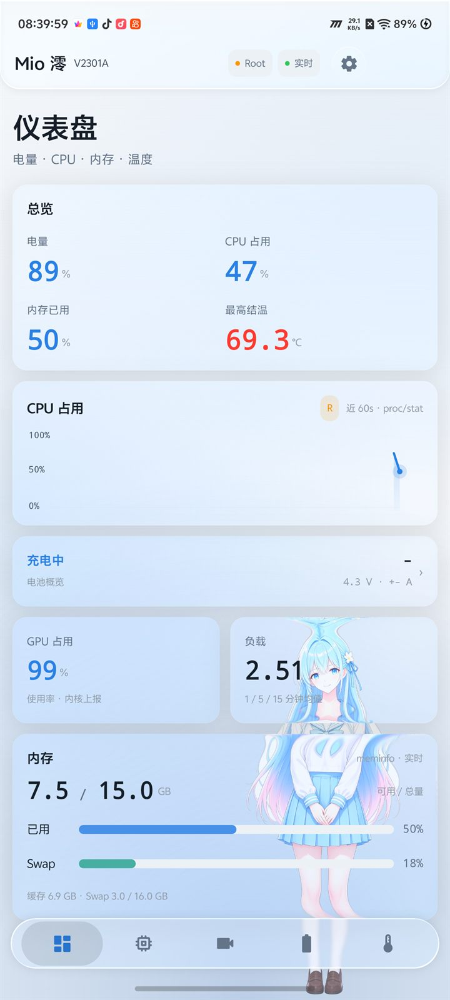
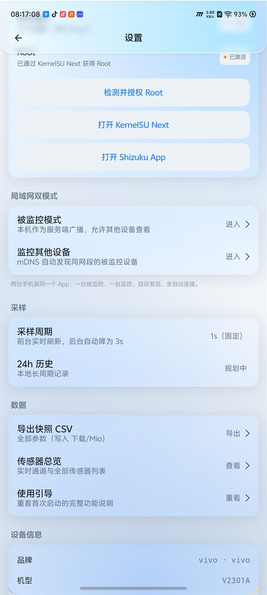
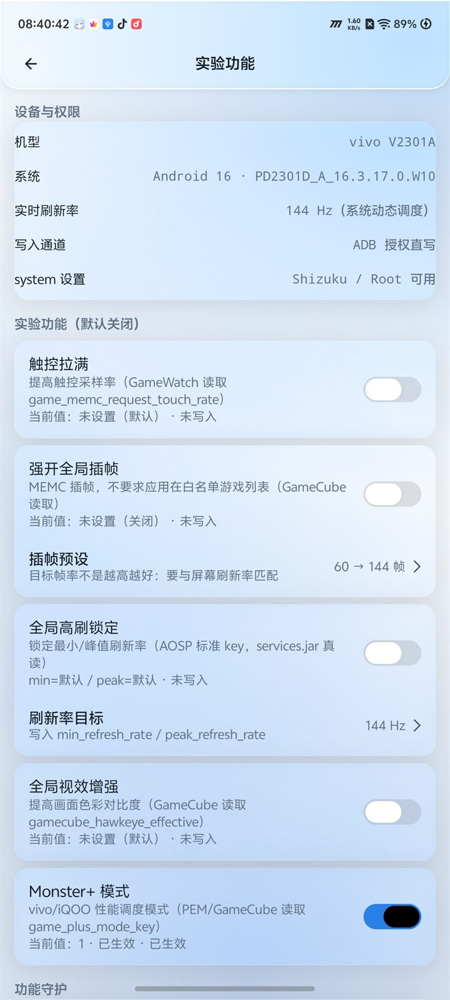

<div align="center">

<p align="center">
  <a href="README.md">简体中文</a> ·
  <b>English</b> ·
  <a href="README.ja.md">日本語</a>
</p>


<h1>Mio</h1>

**Understand your phone's CPU, GPU, battery, and thermals in real time.**

Unofficial personal build of Mio v2.0 · BiliPai / Miuix liquid-glass UI · Root / Shizuku privilege channels

<br/>

[](https://github.com/lingyingaojue/mio-monitor/releases/latest)
[](https://github.com/lingyingaojue/mio-monitor/releases)


[](LICENSE)

<a href="docs/screenshots/v315/dashboard.jpg">
    
</a>

<sub>Captured on a vivo V2301A · Android 16 · unedited</sub>

</div>

---

> [!IMPORTANT]
> This is an **unofficial personal build** based on the [Mio](https://github.com/PRTS168/mio-monitor) v2.0 source. It is not an official release by the original author. Root experiments and Monster+ are added by this fork; evaluate the risks yourself.

## Download

[](https://github.com/lingyingaojue/mio-monitor/releases/latest)

- Latest version: **v3.15.0** (versionCode 450)
- APK: `Mio-3.15.0-debug.apk`
- Requirements: Android 8.0 (API 26) or newer
- **Uninstall the official Mio first**: this build uses the same package name (`com.a41probe.monitor`) but is signed with a different key, so it cannot replace the official app; uninstalling removes app data.

> [!WARNING]
> The APK in Releases is a **debug-signed test build**. It is intended for testing and personal use, not for long-term distribution.

## Features

- **CPU**: per-core frequency and usage, dynamic cluster detection (prime / performance / efficiency), total usage graph, frequency residency, governor and cluster limits, load averages.
- **GPU**: usage, frequency, and core temperature; auto-detects Adreno, Mali, and MediaTek GED nodes.
- **Battery**: level, charge/discharge state, voltage, current, power, health, cycle count, charger input-side values, and a 24-hour capacity trend.
- **Temperature & cooling**: junction and skin temperatures, all thermal zones with trip thresholds, cooling devices, Thermal HAL categories; invalid or constant readings are filtered out.
- **Memory & sensors**: memory / swap breakdown, accelerometer, gyroscope, magnetometer, light, proximity, and other real physical measurements.
- **LAN dual mode**: one device broadcasts via mDNS as the monitored device, another discovers it and shows live charts; no external server is involved.
- **Data export**: CSV with META / RAW / RENDERED sections, preserving kernel raw units and source paths.
- **Appearance**: BiliPai / Miuix liquid-glass UI, three themes, independent character / palette settings, with an option to disable glass effects.

## Screenshots

| Permissions & Root | Experimental features · Monster+ |
|:---:|:---:|
|  |  |

<sub>Monster+ is a Root-only experimental feature, disabled by default; behavior depends on the vivo/iQOO system version.</sub>

## Permissions

| Tier | What can be read / changed |
|---|---|
| **No privilege** (default) | Battery level, battery temperature and voltage, memory, sensors, partial GPU usage, CPU frequency on most devices |
| **Shizuku** (recommended, no Root) | Thermal zones, cooling actions, CPU usage, charger input-side voltage/current, more sysfs nodes |
| **Root** | GPU frequency, cpu0 limits, native charger input, and other SELinux-protected nodes; Root-only experimental features |

Unauthorized cards show an empty state and an authorization entry point; other features remain available. See the [development notes](docs/开发文档.md) for Root details.

## OriginOS experimental features (off by default)

Since v3.5, a whitelist of OriginOS tuning switches has been available. Every switch is off by default and requires risk confirmation on first use:

- Touch boost, global frame interpolation, global high-refresh lock, global visual enhancement;
- v3.15 adds **Monster+ (Root only)**: writes `Settings.System.game_plus_mode_key` via Root and verifies the value by reading it back;
- Original values are backed up before writing and can be restored; ADB direct write and Shizuku are never presented as Root;
- Writing system settings carries risk; see [development notes §7.17 / §7.18](docs/开发文档.md).

## Installation

1. Download the APK from [Releases](https://github.com/lingyingaojue/mio-monitor/releases/latest).
2. Uninstall the official Mio if it is installed (same package name, different signature).
3. Allow "install unknown apps" and install the APK.
4. For full data access, install [Shizuku](https://shizuku.rikka.app/) and authorize it in the app; Root can be used directly if available.

## Build

Requires **JDK 21**, **Android SDK Platform 37**, and **Build Tools 37**:

```bash
./gradlew assembleDebug
# Output: app/build/outputs/apk/debug/app-debug.apk

./gradlew testDebugUnitTest
./gradlew lintDebug
```

Set `sdk.dir` in `local.properties`. The app version is defined in `app/build.gradle.kts`.

### Source baseline

This project is based on the **official Mio v2.0 release source** (tag `v2.0` / `e35dfd3`) with Mio 3.x custom commits on top. The source archive was verified file-by-file against the tag tree (84 files, 0 differences):

```bash
powershell -ExecutionPolicy Bypass -File tools/verify-upstream-source.ps1
```

See [docs/UPSTREAM_SOURCE.md](docs/UPSTREAM_SOURCE.md) for details.

## Documentation

- [Changelog](CHANGELOG.md)
- [Development notes](docs/开发文档.md)
- [Third-party components and licenses](THIRD_PARTY_NOTICES.md)
- [Source baseline](docs/UPSTREAM_SOURCE.md)

## Contributing

- [Contributing guide](CONTRIBUTING.md)
- [Security policy](SECURITY.md)
- README languages: [简体中文](README.md) · [日本語](README.ja.md)

## Credits

- Upstream [Mio / PRTS168](https://github.com/PRTS168/mio-monitor): original monitoring core and data model;
- [BiliPai](https://github.com/jay3-yy/BiliPai): `design-tokens`, `design-system`, `FloatingBottomBar`, and other UI components;
- [Miuix](https://github.com/miuix-kotlin-multiplatform/miuix): Miuix components and Backdrop optical chain;
- [PrismalAGSL](https://github.com/styropyr0/PrismalAGSL): liquid-glass card material;
- [Haze](https://github.com/chrisbanes/haze): fallback path for older Android versions;
- [Shizuku](https://github.com/RikkaApps/Shizuku): Root-free privilege channel.

## License

This project is distributed under the **GNU General Public License v3.0** since v3.0; see [LICENSE](LICENSE). Mio 2.0 and earlier were released by the original author under the MIT License. Vendored BiliPai code retains its original copyright and SPDX notices; see [NOTICE](NOTICE) and [THIRD_PARTY_NOTICES.md](THIRD_PARTY_NOTICES.md).

This project is not affiliated with vivo, iQOO, or the original Mio author. Monster+ / Root tuning may not work on every system version, device, or Root setup; back up your data and use at your own risk.

---

<sub>This is an English translation of the Chinese README. The app screenshots show the Chinese UI. Pull requests to improve the wording are welcome.</sub>
