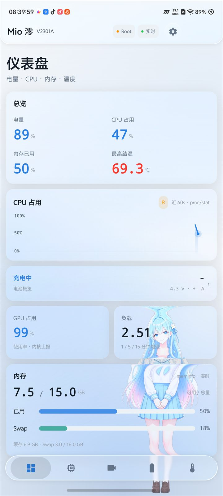
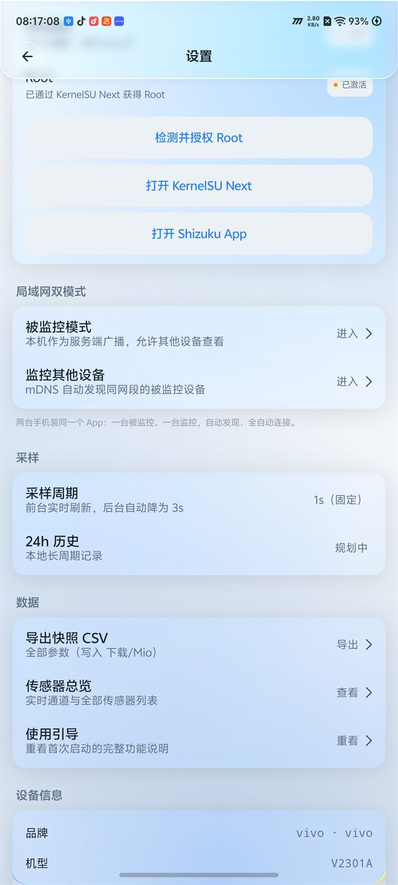
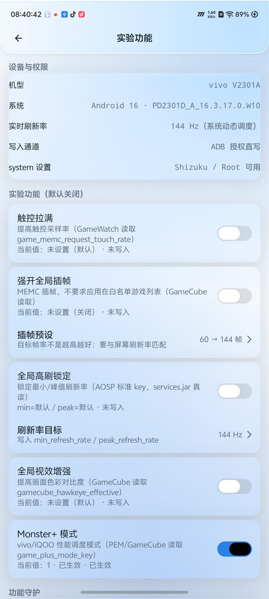

<div align="center">

<p align="center">
  <a href="README.md">简体中文</a> ·
  <a href="README.en.md">English</a> ·
  <b>日本語</b>
</p>


<h1>Mio 澪</h1>

**スマートフォンの CPU・GPU・バッテリー・温度をリアルタイムに可視化。**

Mio v2.0 の個人改造版 · BiliPai / Miuix リキッドグラス UI · Root / Shizuku 権限チャンネル

<br/>

[](https://github.com/lingyingaojue/mio-monitor/releases/latest)
[](https://github.com/lingyingaojue/mio-monitor/releases)


[](LICENSE)

<a href="docs/screenshots/v315/dashboard.jpg">
    
</a>

<sub>vivo V2301A · Android 16 で撮影 · 画像加工なし</sub>

</div>

---

> [!IMPORTANT]
> これは [Mio](https://github.com/PRTS168/mio-monitor) v2.0 のソースを基にした**個人改造版**であり、原作者の公式リリースではありません。Root 実験機能と Monster+ はこのフォークで追加されたものです。リスクを理解した上でご利用ください。

## ダウンロード

[](https://github.com/lingyingaojue/mio-monitor/releases/latest)

- 最新バージョン：**v3.15.0**（versionCode 450）
- APK：`Mio-3.15.0-debug.apk`
- 対応 OS：Android 8.0（API 26）以上
- **公式 Mio を先にアンインストールしてください**：同じパッケージ名 `com.a41probe.monitor` ですが署名が異なるため、上書きインストールできません。アンインストールするとアプリデータも削除されます。

> [!WARNING]
> Releases の APK は **debug 署名のテストビルド**です。試用・個人利用向けであり、長期的な配布には適していません。

## 機能

- **CPU**：コアごとの周波数と使用率、動的クラスタ判定（プライム / パフォーマンス / 効率）、合計使用率グラフ、周波数滞在率、governor とクラスタ上限、ロードアベレージ。
- **GPU**：使用率、周波数、コア温度。Adreno / Mali / MediaTek GED など複数プラットフォームのノードを自動判定します。
- **バッテリー**：残量、充放電状態、電圧、電流、電力、健全性、サイクル数、充電器入力側の値、24 時間の容量推移。
- **温度と冷却**：ジャンクション温度 / 外装温度、全サーマルゾーンと trip しきい値、冷却デバイス、Thermal HAL の分類温度。無効値や一定値は自動的に除外します。
- **メモリとセンサー**：メモリ / Swap の内訳、加速度計、ジャイロ、磁気センサー、照度、近接などの実測値。
- **LAN デュアルモード**：1 台を mDNS で被監視端として公開し、もう 1 台が自動検出してリアルタイムグラフを表示します。外部サーバーは使いません。
- **データ書き出し**：CSV を META / RAW / RENDERED の 3 段構成で出力し、カーネルの生値と取得元パスを保持します。
- **外観**：BiliPai / Miuix のリキッドグラス UI、3 種類のテーマ、キャラクター / 配色の独立設定、ガラス効果の無効化にも対応。

## スクリーンショット

| 権限と Root | 実験機能 · Monster+ |
|:---:|:---:|
|  |  |

<sub>Monster+ は Root 専用の実験機能で、初期状態はオフです。動作は vivo / iQOO のシステムバージョンに依存します。</sub>

## 権限

| 権限レベル | 読み取り / 変更できる範囲 |
|---|---|
| **権限なし**（デフォルト） | バッテリー残量、バッテリー温度と電圧、メモリ、センサー、一部 GPU 使用率、多くの機種の CPU 周波数 |
| **Shizuku**（推奨、Root 不要） | サーマルゾーン温度、冷却アクション、CPU 使用率、充電器入力側の電圧 / 電流、より多くの sysfs ノード |
| **Root** | GPU 周波数、cpu0 の上限、ネイティブ充電入力など SELinux で保護されたノード、および Root 専用実験機能 |

未許可のカードは空状態と権限への導線を表示し、ほかの機能には影響しません。Root の詳細は[開発ドキュメント](docs/开发文档.md)を参照してください。

## OriginOS 実験機能（初期状態はすべてオフ）

v3.5 以降、OriginOS 向けのホワイトリスト調整スイッチを提供しています。すべて初期状態はオフで、初回利用時にリスク確認が必要です：

- タッチブースト、グローバルフレーム補間、グローバル高リフレッシュレート固定、グローバル視覚効果強化；
- v3.15 で **Monster+（Root 専用）** を追加：Root 経由で `Settings.System.game_plus_mode_key` を書き込み、書き込み後に読み戻して検証します；
- 書き込み前に元の値をバックアップし、デフォルト / 元の値へ復元できます。ADB 直接書き込みや Shizuku を Root の代わりには使いません；
- システム設定の書き込みにはリスクがあります。詳細は[開発ドキュメント §7.17 / §7.18](docs/开发文档.md)を参照してください。

## インストール

1. [Releases](https://github.com/lingyingaojue/mio-monitor/releases/latest) から APK をダウンロードします。
2. 公式 Mio がインストールされている場合はアンインストールします（同じパッケージ名で署名が異なるため）。
3. 「提供元不明のアプリ」のインストールを許可して APK をインストールします。
4. すべてのデータを取得するには [Shizuku](https://shizuku.rikka.app/) をインストールしてアプリ内で許可します。Root が利用できる場合は Root チャンネルを直接使えます。

## ビルド

**JDK 21**、**Android SDK Platform 37**、**Build Tools 37** が必要です：

```bash
./gradlew assembleDebug
# 出力：app/build/outputs/apk/debug/app-debug.apk

./gradlew testDebugUnitTest
./gradlew lintDebug
```

`local.properties` に `sdk.dir` を設定してください。バージョンは `app/build.gradle.kts` で管理しています。

### ソースベース

本プロジェクトは **Mio 公式 v2.0 リリースのソース**（tag `v2.0` / `e35dfd3`）をベースに、Mio 3.x の独自コミットを重ねたものです。ソースアーカイブとタグツリーはファイル単位で照合済みです（84 ファイル、差分 0）：

```bash
powershell -ExecutionPolicy Bypass -File tools/verify-upstream-source.ps1
```

詳細は [docs/UPSTREAM_SOURCE.md](docs/UPSTREAM_SOURCE.md) を参照してください。

## ドキュメント

- [更新履歴](CHANGELOG.md)
- [開発ドキュメント](docs/开发文档.md)
- [サードパーティ製コンポーネントとライセンス](THIRD_PARTY_NOTICES.md)
- [ソースベース](docs/UPSTREAM_SOURCE.md)

## 謝辞

- 上流 [Mio / PRTS168](https://github.com/PRTS168/mio-monitor)：元の監視コアとデータモデル；
- [BiliPai](https://github.com/jay3-yy/BiliPai)：`design-tokens`、`design-system`、`FloatingBottomBar` などの UI コンポーネント；
- [Miuix](https://github.com/miuix-kotlin-multiplatform/miuix)：Miuix コンポーネントと Backdrop 光学チェーン；
- [PrismalAGSL](https://github.com/styropyr0/PrismalAGSL)：カードのリキッドグラス素材；
- [Haze](https://github.com/chrisbanes/haze)：旧 Android 向けのガラス代替パス；
- [Shizuku](https://github.com/RikkaApps/Shizuku)：Root 不要の権限チャンネル。

## ライセンス

本プロジェクトは v3.0 以降 **GNU General Public License v3.0** で配布されています。全文は [LICENSE](LICENSE) を参照してください。Mio 2.0 以前は原作者により MIT License で公開されていました。取り込んだ BiliPai のコードは元の著作権表示と SPDX 表記を保持しています。詳細は [NOTICE](NOTICE) および [THIRD_PARTY_NOTICES.md](THIRD_PARTY_NOTICES.md) を参照してください。

本プロジェクトは vivo、iQOO、Mio 原作者と提携関係にありません。Monster+ / Root 調整機能はシステムバージョン、機種、Root 環境によって動作しない場合があります。バックアップの上、自己責任でご利用ください。

---

<sub>このファイルは中国語 README の日本語訳です。アプリのスクリーンショットは中国語 UI です。表現の改善 PR を歓迎します。</sub>
