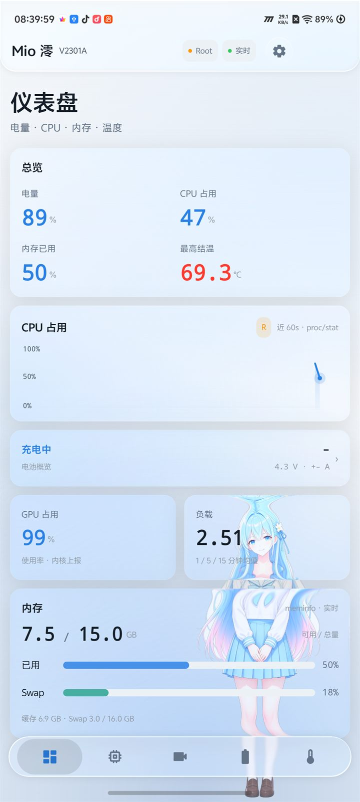
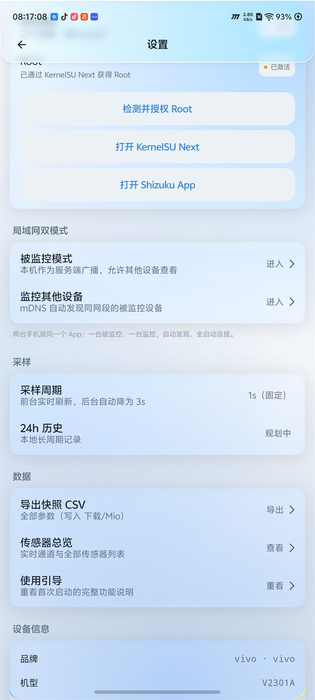
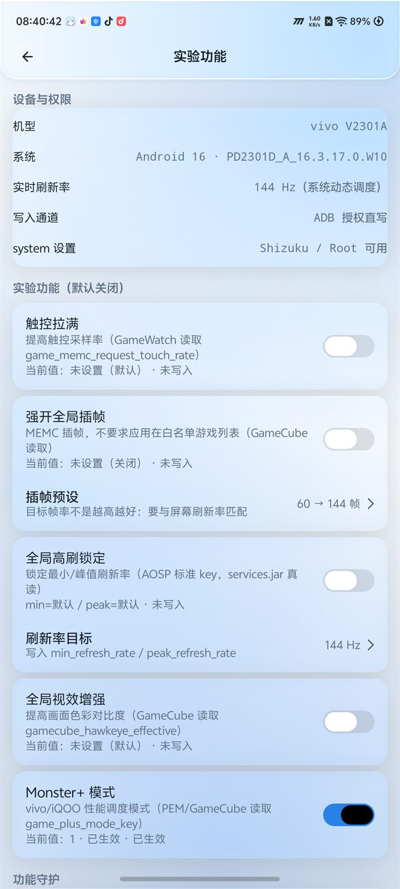

<div align="center">

<p align="center">
  <b>简体中文</b> ·
  <a href="README.en.md">English</a> ·
  <a href="README.ja.md">日本語</a>
</p>


<h1>Mio 澪</h1>

**实时读懂手机的 CPU、GPU、电池与温度。**

Mio v2.0 的个人改造版 · BiliPai / Miuix 液态玻璃 UI · Root / Shizuku 双提权通道

<br/>

[](https://github.com/lingyingaojue/mio-monitor/releases/latest)
[](https://github.com/lingyingaojue/mio-monitor/releases)


[](LICENSE)

<a href="docs/screenshots/v315/dashboard.jpg">
    
</a>

<sub>真机截图 · vivo V2301A · Android 16 · 未作修饰</sub>

</div>

---

> [!IMPORTANT]
> 这是基于 [Mio 澪](https://github.com/PRTS168/mio-monitor) v2.0 源码的**个人改造分支**，不是原作者官方发布。Root 实验功能和 Monster+ 由本分支自行加入，请自行评估风险。

## 下载

[](https://github.com/lingyingaojue/mio-monitor/releases/latest)

- 最新版本：**v3.15.0**（versionCode 450）
- APK：`Mio-3.15.0-debug.apk`
- 系统要求：Android 8.0（API 26）及以上
- **安装前请卸载官方 Mio 或其他签名的 Mio**：本包与官方版同为 `com.a41probe.monitor`，但不使用官方签名，覆盖安装会签名冲突；卸载会清除应用数据。

> [!WARNING]
> Release 中的 APK 为 **debug 签名测试构建**，适合尝鲜和自用，不建议作为长期正式签名版本分发。

## 功能

- **CPU**：每核频率与占用、动态簇识别（超大核 / 性能核 / 能效核）、总占用曲线、频率档位驻留、governor 与簇上限、负载均值。
- **GPU**：占用、频率与核心温度；自动适配 Adreno / Mali / 联发科 GED 等多平台节点。
- **电池**：电量、充放电状态、电压、电流、功率、健康度、循环次数、充电器输入侧数据、24 小时容量趋势。
- **温度与散热**：结温 / 外壳温度、全部热区与 trip 阈值、冷却设备、Thermal HAL 分类温度；自动过滤恒定值与无效热区。
- **内存与传感器**：内存 / Swap 明细，加速度计、陀螺仪、磁力计、光线、距离等真实物理量。
- **局域网双模式**：一台设备作为被监控端通过 mDNS 广播，另一台自动发现并查看实时曲线；不经过外部服务器。
- **数据导出**：CSV 分 META / RAW / RENDERED 三段，保留内核原始单位与来源路径。
- **外观**：BiliPai / Miuix 液态玻璃界面，三种主题与独立角色 / 配色设置，支持关闭玻璃效果。

## 截图

| 权限与 Root | 实验功能 · Monster+ |
|:---:|:---:|
|  |  |

<sub>Monster+ 为 Root 专用实验功能，默认关闭；具体表现取决于 vivo/iQOO 系统版本。</sub>

## 权限

| 档位 | 可读取 / 可操作范围 |
|---|---|
| **免提权**（默认） | 电量、电池温度与电压、内存、传感器、部分 GPU 占用、多数机型的 CPU 频率 |
| **Shizuku**（推荐，无需 Root） | 热区温度、散热动作、CPU 占用、充电器输入侧电压电流、更多 sysfs 节点 |
| **Root** | GPU 频率、cpu0 上限、原生充电输入等受 SELinux 限制的节点，以及 Root 专用实验功能 |

未授权时相关卡片显示空态与授权入口，不影响其余功能。Root 能力见 [v3.14 说明](docs/开发文档.md)。

## OriginOS 实验功能（默认关闭）

v3.5 起提供 OriginOS 调校白名单，所有开关默认关闭、首次进入需确认风险：

- 触控拉满、强开全局插帧、全局高刷锁定、全局视效增强；
- v3.15 新增 **Monster+（Root 专用）**：通过 Root 写入 `Settings.System.game_plus_mode_key`，写入后回读校验；
- 所有写入前备份原值，可一键恢复默认 / 原始值；ADB 直写、Shizuku 不会冒充 Root 写 Monster+；
- 系统设置写入有风险，详见 [开发文档 §7.17 / §7.18](docs/开发文档.md)。

## 安装

1. 从 [Releases](https://github.com/lingyingaojue/mio-monitor/releases/latest) 下载 APK；
2. 先卸载已安装的官方 Mio（同包名不同签名）；
3. 允许「安装未知来源应用」后安装；
4. 需要完整数据时安装 [Shizuku](https://shizuku.rikka.app/) 并在应用内授权；有 Root 时可直接使用 Root 通道。

## 构建

需要 **JDK 21**、**Android SDK Platform 37** 与 **Build Tools 37**：

```bash
./gradlew assembleDebug
# 产物：app/build/outputs/apk/debug/app-debug.apk

./gradlew testDebugUnitTest
./gradlew lintDebug
```

`local.properties` 中配置 `sdk.dir`。版本号在 `app/build.gradle.kts`。

### 源码基线

本项目基线为 **Mio 官方 Releases v2.0 源码包**（tag `v2.0` / `e35dfd3`），并叠加 Mio 3.x 自定义提交。源码包与本地 tag 树已逐文件校验（84 个文件，0 差异）：

```bash
powershell -ExecutionPolicy Bypass -File tools/verify-upstream-source.ps1
```

详见 [docs/UPSTREAM_SOURCE.md](docs/UPSTREAM_SOURCE.md)。

## 文档

- [更新日志](CHANGELOG.md)
- [开发文档](docs/开发文档.md)
- [第三方组件与许可说明](THIRD_PARTY_NOTICES.md)
- [源码基线说明](docs/UPSTREAM_SOURCE.md)

## 参与贡献

- [贡献指南](CONTRIBUTING.md)
- [安全问题报告](SECURITY.md)
- 多语言 README：[English](README.en.md) · [日本語](README.ja.md)

## 致谢

- 上游 [Mio 澪 / PRTS168](https://github.com/PRTS168/mio-monitor)：原始监控内核与数据体系；
- [BiliPai](https://github.com/jay3-yy/BiliPai)：`design-tokens`、`design-system`、`FloatingBottomBar` 等 UI 组件；
- [Miuix](https://github.com/miuix-kotlin-multiplatform/miuix)：Miuix 组件与 Backdrop 光学链；
- [PrismalAGSL](https://github.com/styropyr0/PrismalAGSL)：卡片液态玻璃材质；
- [Haze](https://github.com/chrisbanes/haze)：低版本玻璃降级路径；
- [Shizuku](https://github.com/RikkaApps/Shizuku)：无 Root 提权通道。

## 许可

本项目自 v3.0 起以 **GNU General Public License v3.0** 分发，完整文本见 [LICENSE](LICENSE)。Mio 2.0 及更早版本由原作者以 MIT License 发布；搬运的 BiliPai 代码保留原始版权与 SPDX 声明，详见 [NOTICE](NOTICE) 与 [THIRD_PARTY_NOTICES.md](THIRD_PARTY_NOTICES.md)。

本项目与 vivo、iQOO、Mio 原作者均无隶属关系；Monster+ / Root 调校功能可能因系统版本、机型、Root 方案不同而失效，使用前请自行备份并承担风险。
